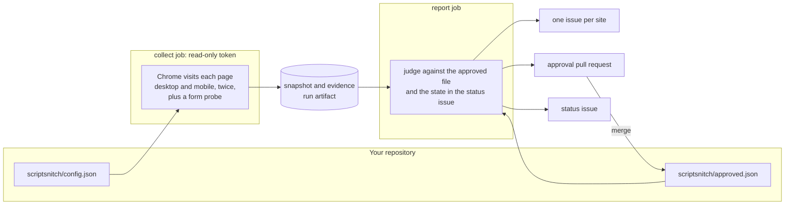

# scriptsnitch

**A GitHub Action that watches the scripts your web pages run and where they send data, against an
approved list in your repository. Anything nobody approved becomes a GitHub issue.**

[](https://github.com/vancoder1/scriptsnitch/actions/workflows/tests.yml)
[](LICENSE)
[](package.json)

Card skimmers and other injected scripts (Magecart, the polyfill.io takeover) work by changing the
JavaScript a page loads, on a third party's server or on the site's own. scriptsnitch visits the
pages you list in a real Chrome, the way a first-time visitor would, records every script, every place
the page sends data, and every listener on a password or card field, types fake values into your
forms to see where they go, and compares all of it with `scriptsnitch/approved.json`. When something
changes that nobody approved, it opens an issue that says what changed, why it matters and what the
code diff is, and proposes the edit to the approved list in a pull request.

- **Few false alarms, by design.** Ordinary deploys of a modern web app, rotating vendor files,
  per-visit tokens and A/B variants do not alert. Every alert is reproducible and explained in plain
  words.
- **Approvals as code.** The approved file is reviewed in pull requests and doubles as the script
  inventory PCI DSS 6.4.3 asks for. High-risk changes are never approved by merging a pull request
  unread.
- **No server, no dependencies.** Node built-ins and the Chrome already on GitHub's runners. The job
  that runs untrusted web pages holds no write token, and the browser sees no token or secret at all.

## Quick start

1. Add the workflow, `.github/workflows/scriptsnitch.yml`:

   ```yaml
   name: scriptsnitch
   on:
     schedule: [{ cron: '17 6 * * *' }]
     push: { branches: [main], paths: ['scriptsnitch/**'] }
     pull_request: { paths: ['scriptsnitch/**'] }
     issue_comment: { types: [created] }
     workflow_dispatch:
   permissions: { contents: write, issues: write, pull-requests: write, actions: read }
   jobs:
     scriptsnitch:
       uses: vancoder1/scriptsnitch/.github/workflows/scriptsnitch.yml@v1
       secrets: { step-secrets: '${{ secrets.SCRIPTSNITCH_STEP_SECRETS }}' }
   ```

2. List your pages in `scriptsnitch/config.json` (all keys under [Configuration](#configuration)):

   ```json
   {
     "notify": ["your-github-name"],
     "pages": [
       { "name": "Home", "url": "https://shop.example/" },
       { "name": "Sign in", "url": "https://shop.example/login", "sensitive": true },
       { "name": "Checkout", "url": "https://shop.example/checkout", "sensitive": true }
     ]
   }
   ```

   Mark sign-in, checkout and payment pages `sensitive`: the rules are stricter there. A checkout
   usually sends an empty cart elsewhere: give it `steps` that add something to the cart, or an
   `expect` selector, so the page you meant is the one watched. The status issue says when a page
   ended on another page.

3. Allow GitHub Actions to open pull requests: **Settings → Actions → General → Workflow permissions →
   Allow GitHub Actions to create and approve pull requests**. Without it, scriptsnitch shows the
   proposed edits in the issue instead.

4. Run the workflow once (**Actions → scriptsnitch → Run workflow**). The first run has nothing
   approved, so it proposes everything it saw in one pull request and opens an issue saying so. Read
   the proposal: **the first inventory is only as clean as your site is today.** Replace each
   `TODO` reason with why the page needs it, look at anything listed under *Pending*, and merge.

From then on it runs every day and stays quiet unless something changes.

**Want a first look without any setup?** From a clone, `node bin/scriptsnitch.js scan https://shop.example/`
prints what one page runs, where it sends data, which fields and frames it has, and its security
headers (see [Command line](#command-line)). `init` writes a starter config and approved file.

## How it works



**Collect.** Each page is visited in a fresh browser profile (no cookies, a first-time visitor),
twice per profile (desktop and mobile), so values that change on every visit (cache busters, nonces,
tracking ids) are learned instead of reported. On pages with a password or card field, a **form probe**
holds the network, types fake but valid-looking values (a Luhn-valid card number, an email, a
password) with real key and mouse events, submits, waits, leaves the page, and records every request,
WebSocket frame, beacon and storage write the page attempted. **Nothing reaches any server**: every
request is answered locally and WebSocket connections are cut before the visit ends. scriptsnitch
never turns on the protocol domains pages can detect, and cookie-consent banners from the common
managers are accepted, because most marketing tags load only after consent.

**Report.** The snapshot is judged against the approved file, with severities from the
[findings table](#what-it-reports). High findings count on the first sighting (skimmers often fire on
a fraction of visits); Medium ones must be seen twice, in two visits of one run or in two runs within
a week. A page that could not be checked (an error page, a bot challenge, a timeout) is
*inconclusive*: it raises nothing and resolves nothing, and three in a row comment on the status issue.

### Telling a real change from a normal one

- **Each script has a stable identity.** External files are identified by the SHA-256 of their bytes
  and by their *slot*, the URL with build tokens and versions replaced: `/assets/index-B7kQ0aRz.js`
  is the slot `/assets/index-{token}.js`. Inline scripts are identified by their code structure, with
  data blobs, prices, nonces and framework payloads (`__NEXT_DATA__`, `self.__next_f`, …) left out, so
  only real code changes count.
- **Trust levels say how much change is fine.** `exact` pins content by hash (the default for
  versioned and hashed third-party files). `origin` lets the vendor update the file and checks its
  behaviour instead (for tag managers and widgets). `deploy` follows your own releases: a new build is
  accepted when the page's own entry bundle gets a new build token, when your build's chunk map names
  the new file, or when an optional `deployMarker` changes. With a `deployMarker` set up, only the
  marker counts as a deploy, since anyone who can edit the HTML can change an entry token. A content
  change at an *unchanged* hashed file name is never accepted, because that is what a tampered file
  looks like.
- **Behaviour is checked on every visit, even for approved scripts.** A new place a script sends data,
  a new listener on a card field, code running while a password is typed, runtime code creation, a
  jump in obfuscation, or a new host name in its code is reported even when the file itself is
  approved. Two or more findings from one script, one of them a behaviour sign, raise all of them to
  High.
- **A shared service is not one origin.** On hosts that serve anyone's files (`cdn.jsdelivr.net`,
  `unpkg.com`, S3 paths) every file counts as its own origin. On services that tell customers apart by
  a key (Google Tag Manager's `?id=`, Analytics' `tid`, Apps Script and webhook paths), a new key is a
  new origin, so an attacker's own container on the approved tag-manager host is caught.
- **Domain risk is checked weekly.** A script or destination host that no longer resolves (anyone
  could register it), a domain that expires within 30 days, or one whose registrar changed since the
  last check.
- **Changed scripts come with a diff.** The previous run's evidence is fetched, both versions are
  formatted into lines, and the added lines that mention a host name, run code, send data or touch a
  sensitive field are marked.

### The issues

- **One issue per site**, rewritten each run with what is live and unapproved, the reasons in plain
  words and the code diffs. A comment (which notifies) is posted only when a new finding appears.
- A Medium finding drops off after two clean runs and returns silently within 30 days. **A High
  finding that disappears stays listed as "not seen since"** until a person closes the issue: attackers
  remove skimmers to cover their tracks. So does a High that a later deploy accepted rather than an
  approval (a file dropped in the build folder, a new inline script on a sensitive page).
- **Closing the issue mutes what is in it**; something new reopens it. The issue closes itself when
  nothing unapproved is live.
- **One status issue** says when the last run was (if that is more than two days old, scriptsnitch has
  stopped running), which pages were checked, and holds the cross-run state.

See [an example site issue](docs/example-issue.md) and [the approval pull request](docs/example-pr.md)
that came with it, both written by a real run against the demo site's tag-manager skimmer.

## Approving changes

- **The approval pull request** edits `approved.json`, one per site. *Routine* proposals (Medium
  findings) become live entries when it is merged. *Pending* proposals (High findings) land in the
  site's `pending` list, which **merging does not approve**: a person investigates and moves each one
  into the live file by hand, with `node bin/scriptsnitch.js approve --id <finding key>`, or with a
  comment.
- **By comment**: `/scriptsnitch approve <finding key> because <reason>` on a site issue approves one
  finding on the approval branch (commenters need write access; merging that pull request is still the
  approval of record). `/scriptsnitch mute <finding key>` mutes one finding.
- While every commit on the approval branch is scriptsnitch's, each run adds new proposals to it and
  keeps it up to date with your default branch. **Once a person has pushed to it, scriptsnitch never
  touches it again**; new findings wait for the next pull request.
- Every entry needs a reason. The `validate` job fails a pull request while a live entry still says
  `TODO`, so a required check can enforce the 6.4.3 justification. Entries not seen for 30 days are
  proposed for removal.
- Commits pushed with the default `GITHUB_TOKEN` start no workflows, so a required `validate` check
  runs on the first commit a person pushes (filling in the reasons). Teams that want checks on every
  bot commit can pass a GitHub App or fine-grained token as `github-token`.

### The approved file

```json
{
  "version": 1,
  "sites": {
    "https://shop.example": {
      "own": ["https://static.shop.example"],
      "scripts": [
        { "id": "jquery", "match": "https://cdn.jsdelivr.net/npm/jquery@3.7.1/dist/jquery.min.js", "trust": "exact",
          "sha256": ["5d0f…"], "pages": ["**"], "reason": "Product gallery", "approved": "2026-11-23" },
        { "id": "app", "match": "https://shop.example/assets/*-{token}.js", "trust": "deploy",
          "pages": ["**", "/login", "/checkout"],
          "behavior": { "hosts": ["api.shop.example"], "listens": ["password:field:input"], "input": true, "eval": false, "obfuscation": "minified" },
          "reason": "Our app's build output", "approved": "2026-11-23" }
      ],
      "destinations": [
        { "match": "https://*.stripe.com", "pages": ["/checkout"], "reason": "Payments", "approved": "2026-11-23" },
        { "match": "POST https://shop.example/api/login", "receives": ["email", "password"], "pages": ["/login"], "reason": "Our sign-in endpoint", "approved": "2026-11-23" }
      ],
      "frames": [{ "match": "https://js.stripe.com", "fields": ["card"], "pages": ["/checkout"], "reason": "Stripe Elements", "approved": "2026-11-23" }],
      "fields": [{ "frame": "top", "form": "POST /login", "field": "password", "kind": "password", "pages": ["/login"], "reason": "Sign-in form", "approved": "2026-11-23" }],
      "allow": [],
      "headers": { "**": { "strict-transport-security": "max-age=31536000" } },
      "pending": []
    }
  }
}
```

- `pages` lists page paths, with `*` and `**`; **a pattern never covers a sensitive page**, which must
  be listed by its exact path. `own` names other origins that are yours. If your bundles come from a
  separate asset host (`assets.shop.example`, a CDN in front of your build), add it to `own`:
  otherwise its files are pinned as third-party files and every deploy reports each one. The first
  approval pull request suggests the hosts that look like yours.
- `destinations` approve where data may go. `receives` names the field kinds an endpoint may receive
  from the probe; without it, nothing typed into a form may reach it, **your own origin included**,
  because a collector planted on your own server is a favourite.
- `behavior` approves what a script may do: hosts in its code, listeners (`kind:role:event`), code
  running during input, runtime code creation, and how obfuscated it may look.
- `headers` is the expected baseline of security headers per page pattern;
  `node bin/scriptsnitch.js approve --headers` adopts the current ones.

## What it reports

| Kind | Raised when | Severity |
| --- | --- | --- |
| `new-origin` | A script from an origin with no approved script for the page, a new file on a host that serves anyone's files, or a new account key | High |
| `new-slot` | A new script at an origin that already has an approved script | Medium |
| `scope` | An approved script appears on a sensitive page its entry does not list | Medium |
| `new-version` | A new version of an approved `exact` third-party file | Medium |
| `content-mismatch` | Content at an approved `exact` URL that matches no approved hash | High |
| `in-place-change` | A content change at an unchanged hashed file name or own versioned URL | High |
| `own-change` | A change to an unversioned own file with no deploy evident | Medium on sensitive pages, Info elsewhere |
| `new-own-script` | A new own script slot no entry covers | High on sensitive pages, Medium elsewhere |
| `build-file` | A new file in an approved build folder that the build does not name, with no deploy | High on sensitive pages, Medium elsewhere |
| `new-inline` | A new inline script not accepted by `deploy` trust | High on sensitive pages with no deploy, Medium otherwise |
| `cloaking` | A file whose bytes differ between Chrome and a direct download | High |
| `new-destination` | A request, beacon, WebSocket, WebTransport or prefetch hint no destination entry covers | High during the probe or on a sensitive page from runtime code or a changed script, Medium otherwise |
| `probe-exfil` | A probe value reached an endpoint that may not receive it, a static-file path, a host name, or browser storage, or a payload grew with the values typed | High |
| `listener` | An unapproved listener on a field, its form or its submit button (High for third-party scripts), or on the page or window | High or Medium |
| `input-code` | Code that ran while sensitive fields were filled, by a script not approved for it | High, Medium for an approved script |
| `new-field` / `frame-field` | A new password or card field, or one inside an iframe not approved for it | High |
| `new-frame` | A new iframe origin with no sensitive fields | Medium |
| `peer-connection` | Live WebRTC connections on a page without an `allow` entry | High |
| `eval` / `obfuscation` / `hostname` | An approved script creates code at runtime, looks more obfuscated, or names a new host in its code | Medium (hostname: Info outside sensitive pages) |
| `domain-dangling` / `domain-expiring` / `domain-changed` | A script or destination host that no longer resolves, expires within 30 days, or changed hands | High / Medium / Medium |
| `headers-weaker` / `csp-source` | A weaker effective security header, or a new host in the CSP | High / Medium |

Info entries (accepted deploys, stronger headers, approved scripts not seen, notes) go to the job
summary and `report.json` only. Three things can never be approved, because the fix is on the site: a
probe value sent to a static file, a card or password kept in browser storage, and a file served
differently to Chrome while approved with `exact` trust.

**Fire drills.** With `drill: true` (the reusable workflow runs one on the first day of each month),
one extra visit per sensitive page adds a harmless test skimmer from a domain that can never exist,
inside the browser only, and the status issue says whether scriptsnitch caught it.

## PCI DSS 4.0.1

scriptsnitch **supports** a merchant's evidence for requirements 6.4.3 and 11.6.1. It does not certify
compliance: the assessor decides.

| Requirement | `exact` trust | `origin` trust | `deploy` trust |
| --- | --- | --- | --- |
| 6.4.3: each script is authorized | An entry merged through a reviewed pull request, with a reason; High findings are proposed as pending and a merge never approves them | same | same |
| 6.4.3: each script's integrity is assured | SHA-256 of the content | The vendor is authorized to update it; every run checks its behaviour, destinations, listeners and domain | Your release process; changes outside an evident deploy are reported, and a change at an unchanged hashed name always is |
| 6.4.3: inventory with a written justification | The approved file; `validate` fails while a live entry has no reason | same | same |
| 11.6.1: alert on unauthorized changes to scripts and security headers, as received by the browser | A daily check in Chrome raises an issue for each unapproved change and each weakened header | same | same |

`mode: evidence` (or `node bin/scriptsnitch.js evidence --since 2026-01-01 --github owner/repo`) writes
an evidence pack: the inventory with reasons and integrity methods, who approved what and when (from
the git history of the approved file; check out with `fetch-depth: 0`), the run log, drill results and
this table.

## Configuration

`scriptsnitch/config.json`. Defaults in brackets.

| Key | Meaning |
| --- | --- |
| `pages` | The pages to watch: `name`, `url`, `site` [the URL's origin], `sensitive` [false], `expect`, `steps`, `probe` [automatic: on pages with a password or card field], `consent`, `settle` (`quietMs`, `scriptQuietMs`, `capMs`) |
| `approved` | Path of the approved file [`scriptsnitch/approved.json`] |
| `notify` | GitHub users assigned to site issues and mentioned on new findings (teams as `org/team` are mentioned only) |
| `profiles` | [`["desktop", "mobile"]`] |
| `block` | Resource types answered locally for speed, still recorded as destinations [`["image", "media", "font"]`] |
| `concurrency` | Pages visited in parallel [4] |
| `requireReasons` | `validate` fails on a `TODO` reason in a live entry [true] |
| `frames` | `"own"` tracks only your own iframes' scripts and requests, `"all"` every iframe's ["own"] |
| `fields` | Extra CSS selectors per field kind, for fields scriptsnitch does not recognise |
| `consent` | `"accept"`, `"ignore"`, or steps of your own ["accept"] |
| `sites` | Per site origin: `deployMarker`, `{"url": …}` (the hash of a file your deploy changes) or `{"page": …, "selector": …, "attribute": …}` |

**`expect`** tells a real page from an error page: `{"selector": "#checkout-form"}` or `{"text": …}`.
Without it, a page counts as loaded once one of its approved own scripts loaded. `validate` warns about
pages with neither.

**Steps** run before the page is judged: `{"goto": url}`, `{"click": selector}`,
`{"type": selector, "value": …}`, `{"type": selector, "secret": "ENV_NAME"}`,
`{"type": selector, "totp": "ENV_NAME"}` (a one-time code from a base32 seed) and `{"wait": selector or
ms}`. Secrets come from the reusable workflow's `step-secrets`, a JSON object such as
`{"SHOP_USER": "…", "SHOP_PASSWORD": "…"}`, reach only the collect step, are masked in logs and are
replaced by `[redacted]` in the snapshot and evidence (values of six characters or more). After the
steps, the page is loaded fresh at its `url`; only that load is judged.

### Action inputs

The reusable workflow takes `config`, `fail-on`, `propose`, `drill` (`auto`, `true`, `false`),
`jitter` and `dry-run`. Using the action directly (`examples/scriptsnitch-two-jobs.yml`):

| Input | Default | Meaning |
| --- | --- | --- |
| `mode` | required | `collect`, `report`, `validate`, `command`, `evidence` or `check` (collect and judge in one job) |
| `config` | `scriptsnitch/config.json` | |
| `out` | `scriptsnitch-out` | Snapshot, evidence, `report.json`, diffs |
| `github-token` | the job token | Used by report, check, command and evidence only |
| `propose` | `pr` | `issue` shows the edits in the issue instead of a pull request |
| `dry-run` | `false` | Judge and write the summary, change nothing on GitHub |
| `fail-on` | `never` | `medium` or `high`: fail the step while such findings are open |
| `drill` | `false` | Run a fire drill (collect) |
| `jitter` | `0` | Wait up to this many minutes before collecting (billed on private repositories) |
| `chrome-path` | found automatically | |
| `allow-no-sandbox` | `false` | Only where Chrome's sandbox cannot work |

Outputs: `high`, `medium`, `inconclusive`, `snapshot`.

## Command line

From a clone (`node bin/scriptsnitch.js <command>`, Node 24 and an installed Chrome; no npm package):

| Command | |
| --- | --- |
| `scan <url> [--probe] [--json]` | What one page runs, sends, contains and serves, with a suggested trust level per script |
| `init <url...>` | Write `scriptsnitch/config.json` with the given pages and their sign-in, cart and checkout links (one level deep), and a first approved file |
| `check [--github owner/repo]` | Collect and judge now. Exit 0 nothing unapproved, 1 findings, 2 a page inconclusive, 3 error. Stateless unless `--github` reads the status issue's state |
| `collect [--drill]` / `report --github owner/repo [--dry-run]` | The two halves of a run |
| `validate` | Check the config and approved file |
| `approve --id <key> [--reason …]` / `--all` / `--headers` | Move one pending proposal into the live file, add every routine proposal of the last `check`, or adopt the current headers |
| `evidence [--since date] [--github owner/repo]` | Write the evidence pack |

Common options: `--config`, `--out`, `--chrome`.

## Known limits

- **A scheduled check from a data center is a tripwire, not a guarantee.** An attack can target only
  some visitors, regions, times, returning visitors or signed-in accounts, and GitHub publishes its
  runners' IP ranges. A self-hosted runner gives a second vantage point; CSP reporting from real
  browsers is the complement.
- A skimmer that uses only approved channels (an approved script's existing listeners and runtime
  code, sending to an approved endpoint under an approved key, encrypted) can pass. The probe narrows
  this; it cannot close it.
- The first inventory is only as clean as the site is on the first run.
- It sees only the pages and steps you list. Inside third-party iframes it tracks origins and fields,
  not code, unless `frames` is `"all"`. A page reachable only through a form POST cannot be watched.
  Pages are told apart by their path, so two pages of one site that differ only in their query
  (`index.php?route=…`) cannot both be watched; the config is refused.
- WebRTC detection is best effort. Domain checks depend on registries answering RDAP; domains whose
  registry does not are reported as unchecked, never as safe.
- **GitHub turns off scheduled workflows in a public repository after 60 days without activity.** The
  status issue's first line says when the last run was.
- Sites without hashed file names show deploys only through a `deployMarker`; without one, every
  change to an own file on a sensitive page is reported.
- The CLI's `check` is stateless: no deploy history and no cross-run confirmation.
- It detects; it does not block. A compromised collect job could hide findings.

## Contributing, security and license

[CONTRIBUTING.md](CONTRIBUTING.md) explains how to change scriptsnitch safely. Report vulnerabilities
privately as described in [SECURITY.md](SECURITY.md). MIT licensed; see [LICENSE](LICENSE). Vendor
families come from [third-party-web](https://github.com/patrickhulce/third-party-web) (MIT, see
`data/NOTICE-third-party-web.md`).
